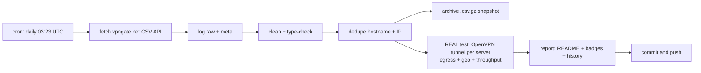

# 🛡️ VPN Gate Monitor

> **Once a day** this repo fetches the complete public [VPN Gate](https://www.vpngate.net/en/) server list, **cleans, deduplicates and archives** it — and then does the part that matters: it **opens a real OpenVPN tunnel to every single listed server**, verifies that traffic genuinely exits through it, checks *where* it exits, and measures real download throughput.
>
> **Everything below this line is the auto-generated living report. No hand-edited numbers.**

[](https://github.com/onlyactions/vpngate-monitor/actions/workflows/vpngate.yml)
[](https://raw.githubusercontent.com/onlyactions/vpngate-monitor/main/badges/servers.json)
[](https://raw.githubusercontent.com/onlyactions/vpngate-monitor/main/badges/alive.json)
[](https://raw.githubusercontent.com/onlyactions/vpngate-monitor/main/badges/speed.json)
[](https://raw.githubusercontent.com/onlyactions/vpngate-monitor/main/badges/updated.json)

## 📊 Latest results

| | |
|---|---|
| **Run** | [#12 · view run](https://github.com/onlyactions/vpngate-monitor/actions/runs/44016482379) · 2026-11-17 04:21:05 UTC · trigger: `schedule` |
| **Servers fetched (unique)** | **98** |
| **Duplicates removed** | 0 exact + 0 same-IP |
| **Servers tested** | **945 of 945** — all 98 current + 847 historical (every server seen in the API within 30 days) |
| **✅ Verified alive** (tunnel up + egress proven) | **397** — 67 from the current list + 330 historical ♻️ |
| **❌ Dead / unusable** | 548 |
| **Usability** | **68.4%** of everything VPN Gate lists right now actually works |
| **⚡ Measured speed (avg / median / max)** | **11.0 / 12.8 / 26.6 Mbps** |
| **🚀 Fastest verified** | **vpn189019752** · 🇯🇵 Japan · **26.6 Mbps** |
| **🧭 Exit-country mismatches** | 3 (server exits somewhere else than it claims) |
| **🤝 Handshake time (alive, avg)** | 3.3 s |

## 🚀 Fastest verified servers

| # | Server | Country | List | Endpoint | Handshake | Measured ↓ | Claimed ↓ | Score |
|---:|---|---|---|---|---:|---:|---:|---:|
| 1 | `vpn189019752` | 🇯🇵 Japan | ♻️ historical | `131.147.36.66:1195`/udp | 2.5s | **26.6 Mbps** | 932.1 Mbps | 610,142 |
| 2 | `vpn616505316` | 🇦🇷 Argentina | ♻️ historical | `186.22.19.196:41552`/udp | 2.5s | **25.4 Mbps** | 110.3 Mbps | 834,755 |
| 3 | `vpn679218486` | 🇯🇵 Japan | ♻️ historical | `124.209.226.195:1752`/udp | 2.5s | **24.4 Mbps** | 682.8 Mbps | 683,399 |
| 4 | `vpn526062445` | 🇯🇵 Japan | ♻️ historical | `60.143.120.123:1632`/udp | 2.8s | **24.3 Mbps** | 538.8 Mbps | 1,465,451 |
| 5 | `vpn909153861` | 🇯🇵 Japan | ♻️ historical | `138.64.96.118:14355`/udp | 2.5s | **23.4 Mbps** | 194.2 Mbps | 812,170 |
| 6 | `vpn702119480` | 🇯🇵 Japan | ♻️ historical | `118.105.160.215:1958`/udp | 2.5s | **23.1 Mbps** | 833.4 Mbps | 611,183 |
| 7 | `vpn729824644` | 🇯🇵 Japan | 📋 current | `217.178.21.239:48214`/udp | 2.5s | **22.7 Mbps** | 366.8 Mbps | 612,757 |
| 8 | `vpn370389678` | 🇯🇵 Japan | ♻️ historical | `133.207.167.224:5623`/udp | 2.5s | **22.7 Mbps** | 309.8 Mbps | 859,697 |
| 9 | `vpn644907313` | 🇯🇵 Japan | ♻️ historical | `126.125.123.228:1401`/udp | 2.8s | **20.4 Mbps** | 93.7 Mbps | 1,107,252 |
| 10 | `vpn711923274` | 🇰🇷 Korea Republic of | ♻️ historical | `59.12.180.71:1625`/udp | 2.5s | **20.1 Mbps** | 44.0 Mbps | 523,019 |

*Measured = 5 MB download through the live tunnel to speed.cloudflare.com. Claimed = the server's self-reported line speed in the VPN Gate API. 'Historical' servers are no longer in the API's current top list but still answered our tunnel — we keep re-testing everything we have ever seen.*

## ⭐ Top-scored & verified alive

| # | Server | Country | Score | Claimed ↓ | Measured ↓ | Sessions | Uptime | Log policy |
|---:|---|---|---:|---:|---:|---:|---:|---|
| 1 | `public-vpn-108` | 🇯🇵 JP | 3,037,443 | 711.2 Mbps | 12.0 Mbps | 140 | 23.9 d | 2weeks |
| 2 | `public-vpn-100` | 🇯🇵 JP | 3,003,937 | 236.1 Mbps | 11.7 Mbps | 179 | 16.9 d | 2weeks |
| 3 | `public-vpn-66` | 🇯🇵 JP | 2,982,274 | 304.6 Mbps | 15.7 Mbps | 95 | 13.9 d | 2weeks |
| 4 | `public-vpn-154` | 🇯🇵 JP | 2,864,520 | 208.0 Mbps | 15.8 Mbps | 104 | 19.9 d | 2weeks |
| 5 | `public-vpn-78` | 🇯🇵 JP | 2,853,500 | 294.3 Mbps | 13.9 Mbps | 126 | 14.9 d | 2weeks |
| 6 | `public-vpn-200` | 🇯🇵 JP | 2,846,412 | 177.2 Mbps | 6.0 Mbps | 51 | 18.9 d | 2weeks |
| 7 | `public-vpn-98` | 🇯🇵 JP | 2,834,846 | 214.7 Mbps | 9.1 Mbps | 89 | 23.9 d | 2weeks |
| 8 | `public-vpn-185` | 🇯🇵 JP | 2,833,369 | 238.2 Mbps | 6.3 Mbps | 121 | 21.9 d | 2weeks |
| 9 | `public-vpn-206` | 🇯🇵 JP | 2,825,566 | 328.0 Mbps | 5.2 Mbps | 70 | 20.9 d | 2weeks |
| 10 | `public-vpn-201` | 🇯🇵 JP | 2,801,280 | 142.4 Mbps | 9.4 Mbps | 104 | 23.9 d | 2weeks |

## 🌍 Countries

| Country | Servers | Verified alive | Best measured ↓ | Fastest server |
|---|---:|---:|---:|---|
| 🇯🇵 Japan (JP) | 444 | 200 | 26.6 Mbps | `vpn189019752` |
| 🇰🇷 Korea Republic of (KR) | 307 | 156 | 20.1 Mbps | `vpn711923274` |
| 🇷🇺 Russian Federation (RU) | 70 | 18 | 19.9 Mbps | `vpn310756240` |
| 🇹🇭 Thailand (TH) | 30 | 4 | 17.1 Mbps | `vpn612027927` |
| 🇺🇸 United States (US) | 25 | 5 | 4.8 Mbps | `vpn519502227` |
| 🇻🇳 Viet Nam (VN) | 11 | 2 | 2.3 Mbps | `vpn209052080` |
| 🇦🇷 Argentina (AR) | 5 | 1 | 25.4 Mbps | `vpn616505316` |
| 🇦🇺 Australia (AU) | 5 | 2 | 8.4 Mbps | `vpn863521180` |
| 🇧🇷 Brazil (BR) | 5 | 0 | 0.0 Mbps | `` |
| 🇵🇪 Peru (PE) | 4 | 1 | 18.9 Mbps | `vpn255850086` |
| 🇮🇩 Indonesia (ID) | 3 | 1 | 13.9 Mbps | `vpn104-cyberdewata` |
| 🇮🇳 India (IN) | 3 | 1 | 11.0 Mbps | `vpn359610091` |
| 🇲🇲 Myanmar (MM) | 3 | 1 | 12.7 Mbps | `vpn477566769` |
| 🇧🇾 Belarus (BY) | 2 | 0 | 0.0 Mbps | `` |
| 🇨🇳 China (CN) | 2 | 1 | 9.0 Mbps | `_unregistered_vpn859862680` |
| 🇪🇨 Ecuador (EC) | 2 | 0 | 0.0 Mbps | `` |
| 🇬🇧 United Kingdom (GB) | 2 | 0 | 0.0 Mbps | `` |
| 🇭🇰 Hong Kong (HK) | 2 | 0 | 0.0 Mbps | `` |
| 🇭🇷 Croatia (LOCAL Name: Hrvatska) (HR) | 2 | 2 | 1.3 Mbps | `vpn962496160` |
| 🇲🇽 Mexico (MX) | 2 | 0 | 0.0 Mbps | `` |
| 🇲🇾 Malaysia (MY) | 2 | 0 | 0.0 Mbps | `` |
| 🇵🇭 Philippines (PH) | 2 | 0 | 0.0 Mbps | `` |
| 🇹🇼 Taiwan (TW) | 2 | 1 | 0.8 Mbps | `vpn503500791` |
| 🇨🇦 Canada (CA) | 1 | 0 | 0.0 Mbps | `` |
| 🇨🇴 Colombia (CO) | 1 | 0 | 0.0 Mbps | `` |
| 🇫🇷 France (FR) | 1 | 0 | 0.0 Mbps | `` |
| 🇮🇹 Italy (IT) | 1 | 0 | 0.0 Mbps | `` |
| 🇯🇴 Jordan (JO) | 1 | 0 | 0.0 Mbps | `` |
| 🇳🇱 Netherlands (NL) | 1 | 0 | 0.0 Mbps | `` |
| 🇵🇸 Palestinian Territory Occupied (PS) | 1 | 1 | 3.5 Mbps | `vpn921472991` |
| 🇵🇹 Portugal (PT) | 1 | 0 | 0.0 Mbps | `` |
| 🇷🇴 Romania (RO) | 1 | 0 | 0.0 Mbps | `` |
| 🇻🇪 Venezuela (VE) | 1 | 0 | 0.0 Mbps | `` |

## 🕵️ Claim vs. reality

The VPN Gate `Speed` field is whatever the server *claims*. Here is the truth, measured through a live tunnel — the hall of shame (claimed ≫ delivered):

| Server | Country | Claims | Delivers | Reality ratio |
|---|---|---:|---:|---:|
| `vpn859630625` | 🇰🇷 KR | 93 Mbps | 0.1 Mbps | 0% |
| `vpn517964018` | 🇰🇷 KR | 87 Mbps | 0.1 Mbps | 0% |
| `vpn175155645` | 🇯🇵 JP | 28 Mbps | 0.0 Mbps | 0% |
| `vpn586484862` | 🇰🇷 KR | 729 Mbps | 1.2 Mbps | 0% |
| `vpn855340230` | 🇰🇷 KR | 95 Mbps | 0.3 Mbps | 0% |
| `vpn290308527` | 🇯🇵 JP | 262 Mbps | 0.8 Mbps | 0% |
| `vpn541474874` | 🇰🇷 KR | 418 Mbps | 1.4 Mbps | 0% |
| `public-vpn-198` | 🇯🇵 JP | 533 Mbps | 1.9 Mbps | 0% |
| `vpn451666403` | 🇰🇷 KR | 661 Mbps | 2.4 Mbps | 0% |
| `vpn598447077` | 🇯🇵 JP | 97 Mbps | 0.4 Mbps | 0% |

Most honest of this round: `vpn648203125` (12 Mbps), `vpn890053288` (14 Mbps), `vpn757870457` (12 Mbps), `vpn244093263` (14 Mbps), `vpn501671840` (5 Mbps).

## 🧭 Exit-country mismatches

These servers are listed under one country but your traffic **actually exits somewhere else** (verified via Cloudflare's geo view of the exit IP) — useful to know before you trust one:

| Server | Claims | Actually exits via | Exit IP | Measured ↓ |
|---|---|---|---|---:|
| `vpn962496160` | 🇭🇷 HR | 🇧🇬 BG | `150.40.105.24` | 1.3 Mbps |
| `vpn457795651` | 🇭🇷 HR | 🇧🇬 BG | `150.40.105.20` | 1.3 Mbps |
| `vpn921472991` | 🇵🇸 PS | 🇺🇸 US | `172.110.223.66` | 3.5 Mbps |

## 📈 History

Alive % trend (last 22 runs): `██▇▆▆▁▄▅▄▃▄█▄▄▄▄▄▄▃▃▃▃`

Avg measured speed (Mbps): `▄▅▁▅▁▆▅▄▁▃▁▄▃▄▄▅▅██▄▅█`

| Run at | Fetched | Alive | Alive % | Avg ↓ | Max ↓ | Mismatches |
|---|---:|---:|---:|---:|---:|---:|
| 2026-11-16 04:58:07 UTC | 94 | 366 | 42% | 14.3 | 35.9 | 1 |
| 2026-11-15 04:20:41 UTC | 90 | 334 | 41% | 12.4 | 29.8 | 0 |
| 2026-11-14 04:17:29 UTC | 98 | 323 | 44% | 11.3 | 54.8 | 2 |
| 2026-11-13 04:22:35 UTC | 97 | 295 | 44% | 14.9 | 46.8 | 1 |
| 2026-11-12 04:23:10 UTC | 93 | 272 | 46% | 15.0 | 29.9 | 0 |
| 2026-11-11 04:22:55 UTC | 97 | 234 | 45% | 12.0 | 28.2 | 0 |
| 2026-11-10 04:16:47 UTC | 95 | 205 | 46% | 12.6 | 65.4 | 1 |
| 2026-11-09 04:26:43 UTC | 93 | 164 | 45% | 11.4 | 39.3 | 0 |
| 2026-11-08 04:18:29 UTC | 97 | 134 | 49% | 11.5 | 47.3 | 1 |
| 2026-11-07 04:14:58 UTC | 93 | 88 | 48% | 10.9 | 27.0 | 1 |
| 2026-11-06 09:50:11 UTC | 96 | 69 | 72% | 11.8 | 26.2 | 0 |
| 2026-10-05 14:10:31 UTC | 95 | 434 | 45% | 8.8 | 52.2 | 4 |
| 2026-10-05 05:01:08 UTC | 94 | 394 | 44% | 10.9 | 50.4 | 3 |
| 2026-10-03 16:01:20 UTC | 98 | 368 | 45% | 8.8 | 33.1 | 4 |
| 2026-10-03 11:25:01 UTC | 99 | 388 | 52% | 11.8 | 37.9 | 5 |

## ⚙️ How the pipeline works



1. **Fetch** — `GET /api/iphone/` with retries and endpoint fallback; responses are validated (the API sometimes serves an empty placeholder page to datacenter IPs) and the raw bytes are logged and hashed (sha256).
2. **Clean** — parse the special CSV (`*vpn_servers` marker, `#`-prefixed header), type-check every numeric field, validate IPs, drop broken rows, strip noise.
3. **Dedupe** — remove exact `(HostName, IP)` duplicates, then same-IP entries keeping the highest-scoring one.
4. **Archive** — every run writes an immutable gzipped snapshot to `archive/` (auto-pruned to the newest 360 ≈ 90 days).
5. **Test — the real deal.** For **every** server, every run — not just the API's current list, but **the union of every server that has ever appeared** within the 30-day recall window (kept in `data/known_servers.json`): decode the shared VPN Gate OpenVPN template (all servers ship the same CA + dummy client cert — verified), rebuild each server's config with its remembered `(proto, port)`, force it onto a per-worker `tun` device, disable pushed routes, pin two /32 routes through the tunnel to per-worker Cloudflare anycast IPs, wait for *Initialization Sequence Completed*, then verify egress (`cdn-cgi/trace` through the tunnel must return a foreign exit IP + real exit country) and measure a 5 MB download through the same tunnel. Up to 48 isolated tunnels run in parallel; a server that never completes the handshake is hard-killed after 25 s.
6. **Report** — this README, four live badges, `latest.json`, `summary.json` and the `history.jsonl` log are regenerated and committed by `github-actions[bot]`.

## 📁 Data files & programmatic use

All results are in this repo — hotlink them straight from `https://github.com/onlyactions/vpngate-monitor`:

- [`data/latest.json`](https://raw.githubusercontent.com/onlyactions/vpngate-monitor/main/data/latest.json) — the merged dataset: every cleaned server + its latest real test result
- [`data/servers_clean.csv`](https://raw.githubusercontent.com/onlyactions/vpngate-monitor/main/data/servers_clean.csv) — cleaned, deduplicated server list (no bulky config blobs)
- [`data/summary.json`](https://raw.githubusercontent.com/onlyactions/vpngate-monitor/main/data/summary.json) — compact run summary with failure breakdown
- [`data/history.jsonl`](https://raw.githubusercontent.com/onlyactions/vpngate-monitor/main/data/history.jsonl) — one JSON line per run, append-only
- [`archive/`](https://github.com/onlyactions/vpngate-monitor/tree/main/archive) — immutable gzipped snapshots of every run
- full logs, raw API response and per-server error details are attached to each [Actions run](https://github.com/onlyactions/vpngate-monitor/actions) as artifacts (30-day retention)

Grab a working VPN right now:

```bash
curl -s https://raw.githubusercontent.com/onlyactions/vpngate-monitor/main/data/latest.json \
  | python3 -c "import json,sys;[print(s['IP'],s['CountryShort'],s['test']['download_mbps'],'Mbps') for s in json.load(sys.stdin) if s['test'] and s['test']['alive']]" \
  | sort -k3 -nr | head
```

Field units: `Score` points · `Ping` ms · `Speed` bit/s (self-reported) · `Uptime` ms · `TotalUsers` count · `TotalTraffic` bytes · `download_mbps` Mbps (measured through the tunnel).

## 🔬 Methodology & caveats

- **Real tunnels, not CSV checks.** A server only counts as alive if OpenVPN completed its handshake *and* an HTTPS request bound to the tunnel egressed with a foreign IP. A server whose tunnel silently black-holes traffic fails the egress step and is reported dead.
- **No DNS through the VPN.** Test destinations are pinned with `curl --resolve` to per-worker Cloudflare anycast addresses, so a broken/hijacking VPN DNS can never fake a success.
- **Throughput** is one 5 MB download to `speed.cloudflare.com` through the live tunnel — a sample, not a lab measurement.
- **Vantage point**: GitHub Actions runners (Azure, usually US/EU). A server that is slow from there may be fast from your country, and vice versa.
- **Fairness**: volunteer servers are shared — measured speeds dip when many clients are connected (`NumVpnSessions` is listed).
- **Security**: test traffic is TLS to Cloudflare only; we never send anything sensitive through volunteer servers. Neither should you — assume the operator can see traffic metadata.

## ⚠️ Disclaimer

- [VPN Gate](https://www.vpngate.net/en/) is an academic experiment by the University of Tsukuba, Japan (Daiyuu Nobori & co). This project is an independent monitor of its public API and is **not affiliated** with it.
- VPN servers are run by volunteers; some keep connection logs (see `LogType`). Use them legally and responsibly; do not route anything private or illegal through them.
- Data is provided **as-is** for research/educational purposes.

## 📄 License

Code: MIT. Data: originates from VPN Gate's public API — respect their terms.

---
*Auto-generated by [run #12](https://github.com/onlyactions/vpngate-monitor/actions/runs/44016482379) at 2026-11-17 04:26:55 UTC. Next scheduled run: daily at 03:23 UTC.*
