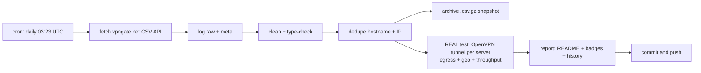

# 🛡️ VPN Gate Monitor

> **Once a day** this repo fetches the complete public [VPN Gate](https://www.vpngate.net/en/) server list, **cleans, deduplicates and archives** it — and then does the part that matters: it **opens a real OpenVPN tunnel to every single listed server**, verifies that traffic genuinely exits through it, checks *where* it exits, and measures real download throughput.
>
> **Everything below this line is the auto-generated living report. No hand-edited numbers.**

[](https://github.com/bhaylorina/vpngate-monitor/actions/workflows/vpngate.yml)
[](https://raw.githubusercontent.com/bhaylorina/vpngate-monitor/main/badges/servers.json)
[](https://raw.githubusercontent.com/bhaylorina/vpngate-monitor/main/badges/alive.json)
[](https://raw.githubusercontent.com/bhaylorina/vpngate-monitor/main/badges/speed.json)
[](https://raw.githubusercontent.com/bhaylorina/vpngate-monitor/main/badges/updated.json)

## 📊 Latest results

| | |
|---|---|
| **Run** | [#36 · view run](https://github.com/bhaylorina/vpngate-monitor/actions/runs/46157208635) · 2026-11-28 14:56:44 UTC · trigger: `schedule` |
| **Servers fetched (unique)** | **95** |
| **Duplicates removed** | 0 exact + 0 same-IP |
| **Servers tested** | **11 of 2,821** — all 95 current + 2,726 historical (every server seen in the API within 30 days) |
| **✅ Verified alive** (tunnel up + egress proven) | **2** — 0 from the current list + 2 historical ♻️ |
| **❌ Dead / unusable** | 9 |
| **Usability** | **0.0%** of everything VPN Gate lists right now actually works |
| **⚡ Measured speed (avg / median / max)** | **10.7 / 12.0 / 12.0 Mbps** |
| **🚀 Fastest verified** | **vpn359610091-udp** · 🇮🇳 India · **12.0 Mbps** |
| **🧭 Exit-country mismatches** | 0 (server exits somewhere else than it claims) |
| **🤝 Handshake time (alive, avg)** | 2.9 s |
| **Untested** | 2,810 |

## 🚀 Fastest verified servers

| # | Server | Country | List | Endpoint | Handshake | Measured ↓ | Claimed ↓ | Score |
|---:|---|---|---|---|---:|---:|---:|---:|
| 1 | `vpn359610091-udp` | 🇮🇳 India | ♻️ historical | `103.172.220.133:1195`/udp | 2.5s | **12.0 Mbps** | 10.0 Mbps | 150,000 |
| 2 | `vpn359610091` | 🇮🇳 India | ♻️ historical | `103.172.220.133:995`/tcp | 3.3s | **9.4 Mbps** | 7.6 Mbps | 1,215,566 |

*Measured = 5 MB download through the live tunnel to speed.cloudflare.com. Claimed = the server's self-reported line speed in the VPN Gate API. 'Historical' servers are no longer in the API's current top list but still answered our tunnel — we keep re-testing everything we have ever seen.*

## ⭐ Top-scored & verified alive

| # | Server | Country | Score | Claimed ↓ | Measured ↓ | Sessions | Uptime | Log policy |
|---:|---|---|---:|---:|---:|---:|---:|---|
| 1 | `vpn359610091` | 🇮🇳 IN | 1,215,566 | 7.6 Mbps | 9.4 Mbps | 74 | 40.0 d | 2weeks |
| 2 | `vpn359610091-udp` | 🇮🇳 IN | 150,000 | 10.0 Mbps | 12.0 Mbps | 1 | 1.0 h | 2weeks |

## 🌍 Countries

| Country | Servers | Verified alive | Best measured ↓ | Fastest server |
|---|---:|---:|---:|---|
| 🇯🇵 Japan (JP) | 1,144 | 0 | 0.0 Mbps | `` |
| 🇰🇷 Korea Republic of (KR) | 958 | 0 | 0.0 Mbps | `` |
| 🇷🇺 Russian Federation (RU) | 262 | 0 | 0.0 Mbps | `` |
| 🇹🇭 Thailand (TH) | 173 | 0 | 0.0 Mbps | `` |
| 🇺🇸 United States (US) | 75 | 0 | 0.0 Mbps | `` |
| 🇻🇳 Viet Nam (VN) | 55 | 0 | 0.0 Mbps | `` |
| 🇮🇳 India (IN) | 19 | 2 | 12.0 Mbps | `vpn359610091-udp` |
| 🇦🇺 Australia (AU) | 14 | 0 | 0.0 Mbps | `` |
| 🇬🇧 United Kingdom (GB) | 10 | 0 | 0.0 Mbps | `` |
| 🇭🇷 Croatia (LOCAL Name: Hrvatska) (HR) | 10 | 0 | 0.0 Mbps | `` |
| 🇦🇷 Argentina (AR) | 8 | 0 | 0.0 Mbps | `` |
| 🇧🇷 Brazil (BR) | 7 | 0 | 0.0 Mbps | `` |
| 🇮🇩 Indonesia (ID) | 7 | 0 | 0.0 Mbps | `` |
| 🇨🇦 Canada (CA) | 6 | 0 | 0.0 Mbps | `` |
| 🇲🇽 Mexico (MX) | 6 | 0 | 0.0 Mbps | `` |
| 🇵🇪 Peru (PE) | 6 | 0 | 0.0 Mbps | `` |
| 🇧🇾 Belarus (BY) | 3 | 0 | 0.0 Mbps | `` |
| 🇨🇳 China (CN) | 3 | 0 | 0.0 Mbps | `` |
| 🇫🇷 France (FR) | 3 | 0 | 0.0 Mbps | `` |
| 🇭🇰 Hong Kong (HK) | 3 | 0 | 0.0 Mbps | `` |
| 🇲🇲 Myanmar (MM) | 3 | 0 | 0.0 Mbps | `` |
| 🇲🇾 Malaysia (MY) | 3 | 0 | 0.0 Mbps | `` |
| 🇵🇭 Philippines (PH) | 3 | 0 | 0.0 Mbps | `` |
| 🇻🇪 Venezuela (VE) | 3 | 0 | 0.0 Mbps | `` |
| 🇦🇪 United Arab Emirates (AE) | 2 | 0 | 0.0 Mbps | `` |
| 🇪🇨 Ecuador (EC) | 2 | 0 | 0.0 Mbps | `` |
| 🇫🇮 Finland (FI) | 2 | 0 | 0.0 Mbps | `` |
| 🇮🇷 Iran (ISLAMIC Republic Of) (IR) | 2 | 0 | 0.0 Mbps | `` |
| 🇯🇴 Jordan (JO) | 2 | 0 | 0.0 Mbps | `` |
| 🇱🇻 Latvia (LV) | 2 | 0 | 0.0 Mbps | `` |
| 🇳🇱 Netherlands (NL) | 2 | 0 | 0.0 Mbps | `` |
| 🇳🇿 New Zealand (NZ) | 2 | 0 | 0.0 Mbps | `` |
| 🇹🇼 Taiwan (TW) | 2 | 0 | 0.0 Mbps | `` |
| 🇺🇦 Ukraine (UA) | 2 | 0 | 0.0 Mbps | `` |
| 🇦🇹 Austria (AT) | 1 | 0 | 0.0 Mbps | `` |
| 🇨🇭 Switzerland (CH) | 1 | 0 | 0.0 Mbps | `` |
| 🇨🇴 Colombia (CO) | 1 | 0 | 0.0 Mbps | `` |
| 🇨🇿 Czech Republic (CZ) | 1 | 0 | 0.0 Mbps | `` |
| 🇩🇪 Germany (DE) | 1 | 0 | 0.0 Mbps | `` |
| 🇪🇪 Estonia (EE) | 1 | 0 | 0.0 Mbps | `` |
| … | +11 more countries | | | |

## 🕵️ Claim vs. reality

The VPN Gate `Speed` field is whatever the server *claims*. Here is the truth, measured through a live tunnel — the hall of shame (claimed ≫ delivered):

| Server | Country | Claims | Delivers | Reality ratio |
|---|---|---:|---:|---:|
| `vpn359610091-udp` | 🇮🇳 IN | 10 Mbps | 12.0 Mbps | 120% |
| `vpn359610091` | 🇮🇳 IN | 8 Mbps | 9.4 Mbps | 123% |

Most honest of this round: `vpn359610091` (9 Mbps), `vpn359610091-udp` (12 Mbps).

## 🧭 Exit-country mismatches

. ✅ Every verified server exits where it claims.

## 📈 History

Alive % trend (last 59 runs): `██▇▆▆▃▅▆▅▅▅█▅▅▅▅▅▅▅▅▅▅▅▄▅▄▃▃██▆█████▅▅█▄▄▁▄▂▅▅▆▅▄▄▄▃▃▃▁▃▁▃▁`

Avg measured speed (Mbps): `▆▆▄▆▅▇▆▆▄▆▄▆▆▆▆▆▆██▆▆▇▆▇▆▅▅█▆▆▇▇▅▄▆▆▆█▆▆▆▇█▅▄▇█▇▂█▁▆▅▅▇▅`

| Run at | Fetched | Alive | Alive % | Avg ↓ | Max ↓ | Mismatches |
|---|---:|---:|---:|---:|---:|---:|
| 2026-11-28 00:59:01 UTC | 93 | 1 | 8% | 9.6 | 9.6 | 0 |
| 2026-11-27 15:59:51 UTC | 99 | 3 | 25% | 13.5 | 15.9 | 0 |
| 2026-11-27 01:25:47 UTC | 92 | 0 | 0% | 0.0 | 0.0 | 0 |
| 2026-11-26 16:14:58 UTC | 93 | 2 | 20% | 10.3 | 13.0 | 0 |
| 2026-11-26 01:28:21 UTC | 92 | 0 | 0% | 0.0 | 0.0 | 0 |
| 2026-11-25 16:41:31 UTC | 98 | 2 | 22% | 10.5 | 12.7 | 0 |
| 2026-11-25 01:51:34 UTC | 88 | 2 | 20% | 12.1 | 14.4 | 0 |
| 2026-11-24 16:53:19 UTC | 94 | 2 | 20% | 1.8 | 2.3 | 0 |
| 2026-11-24 03:44:05 UTC | 94 | 3 | 30% | 14.8 | 15.7 | 0 |
| 2026-11-23 17:11:05 UTC | 88 | 3 | 33% | 4.1 | 10.3 | 0 |
| 2026-11-23 05:22:26 UTC | 94 | 3 | 30% | 13.6 | 17.5 | 0 |
| 2026-11-22 23:08:33 UTC | 91 | 4 | 44% | 15.1 | 20.0 | 0 |
| 2026-11-22 13:56:52 UTC | 92 | 4 | 50% | 12.9 | 15.4 | 0 |
| 2026-11-22 04:44:28 UTC | 97 | 3 | 43% | 8.7 | 14.8 | 0 |
| 2026-11-21 22:42:11 UTC | 92 | 3 | 43% | 9.3 | 15.8 | 0 |

## ⚙️ How the pipeline works



1. **Fetch** — `GET /api/iphone/` with retries and endpoint fallback; responses are validated (the API sometimes serves an empty placeholder page to datacenter IPs) and the raw bytes are logged and hashed (sha256).
2. **Clean** — parse the special CSV (`*vpn_servers` marker, `#`-prefixed header), type-check every numeric field, validate IPs, drop broken rows, strip noise.
3. **Dedupe** — remove exact `(HostName, IP)` duplicates, then same-IP entries keeping the highest-scoring one.
4. **Archive** — every run writes an immutable gzipped snapshot to `archive/` (auto-pruned to the newest 360 ≈ 90 days).
5. **Test — the real deal.** For **every** server, every run — not just the API's current list, but **the union of every server that has ever appeared** within the 30-day recall window (kept in `data/known_servers.json`): decode the shared VPN Gate OpenVPN template (all servers ship the same CA + dummy client cert — verified), rebuild each server's config with its remembered `(proto, port)`, force it onto a per-worker `tun` device, disable pushed routes, pin two /32 routes through the tunnel to per-worker Cloudflare anycast IPs, wait for *Initialization Sequence Completed*, then verify egress (`cdn-cgi/trace` through the tunnel must return a foreign exit IP + real exit country) and measure a 5 MB download through the same tunnel. Up to 48 isolated tunnels run in parallel; a server that never completes the handshake is hard-killed after 25 s.
6. **Report** — this README, four live badges, `latest.json`, `summary.json` and the `history.jsonl` log are regenerated and committed by `github-actions[bot]`.

## 📁 Data files & programmatic use

All results are in this repo — hotlink them straight from `https://github.com/bhaylorina/vpngate-monitor`:

- [`data/latest.json`](https://raw.githubusercontent.com/bhaylorina/vpngate-monitor/main/data/latest.json) — the merged dataset: every cleaned server + its latest real test result
- [`data/servers_clean.csv`](https://raw.githubusercontent.com/bhaylorina/vpngate-monitor/main/data/servers_clean.csv) — cleaned, deduplicated server list (no bulky config blobs)
- [`data/summary.json`](https://raw.githubusercontent.com/bhaylorina/vpngate-monitor/main/data/summary.json) — compact run summary with failure breakdown
- [`data/history.jsonl`](https://raw.githubusercontent.com/bhaylorina/vpngate-monitor/main/data/history.jsonl) — one JSON line per run, append-only
- [`archive/`](https://github.com/bhaylorina/vpngate-monitor/tree/main/archive) — immutable gzipped snapshots of every run
- full logs, raw API response and per-server error details are attached to each [Actions run](https://github.com/bhaylorina/vpngate-monitor/actions) as artifacts (30-day retention)

Grab a working VPN right now:

```bash
curl -s https://raw.githubusercontent.com/bhaylorina/vpngate-monitor/main/data/latest.json \
  | python3 -c "import json,sys;[print(s['IP'],s['CountryShort'],s['test']['download_mbps'],'Mbps') for s in json.load(sys.stdin) if s['test'] and s['test']['alive']]" \
  | sort -k3 -nr | head
```

Field units: `Score` points · `Ping` ms · `Speed` bit/s (self-reported) · `Uptime` ms · `TotalUsers` count · `TotalTraffic` bytes · `download_mbps` Mbps (measured through the tunnel).

## 🔬 Methodology & caveats

- **Real tunnels, not CSV checks.** A server only counts as alive if OpenVPN completed its handshake *and* an HTTPS request bound to the tunnel egressed with a foreign IP. A server whose tunnel silently black-holes traffic fails the egress step and is reported dead.
- **No DNS through the VPN.** Test destinations are pinned with `curl --resolve` to per-worker Cloudflare anycast addresses, so a broken/hijacking VPN DNS can never fake a success.
- **Throughput** is one 5 MB download to `speed.cloudflare.com` through the live tunnel — a sample, not a lab measurement.
- **Vantage point**: GitHub Actions runners (Azure, usually US/EU). A server that is slow from there may be fast from your country, and vice versa.
- **Fairness**: volunteer servers are shared — measured speeds dip when many clients are connected (`NumVpnSessions` is listed).
- **Security**: test traffic is TLS to Cloudflare only; we never send anything sensitive through volunteer servers. Neither should you — assume the operator can see traffic metadata.

## ⚠️ Disclaimer

- [VPN Gate](https://www.vpngate.net/en/) is an academic experiment by the University of Tsukuba, Japan (Daiyuu Nobori & co). This project is an independent monitor of its public API and is **not affiliated** with it.
- VPN servers are run by volunteers; some keep connection logs (see `LogType`). Use them legally and responsibly; do not route anything private or illegal through them.
- Data is provided **as-is** for research/educational purposes.

## 📄 License

Code: MIT. Data: originates from VPN Gate's public API — respect their terms.

---
*Auto-generated by [run #36](https://github.com/bhaylorina/vpngate-monitor/actions/runs/46157208635) at 2026-11-28 14:57:49 UTC. Next scheduled run: daily at 03:23 UTC.*
